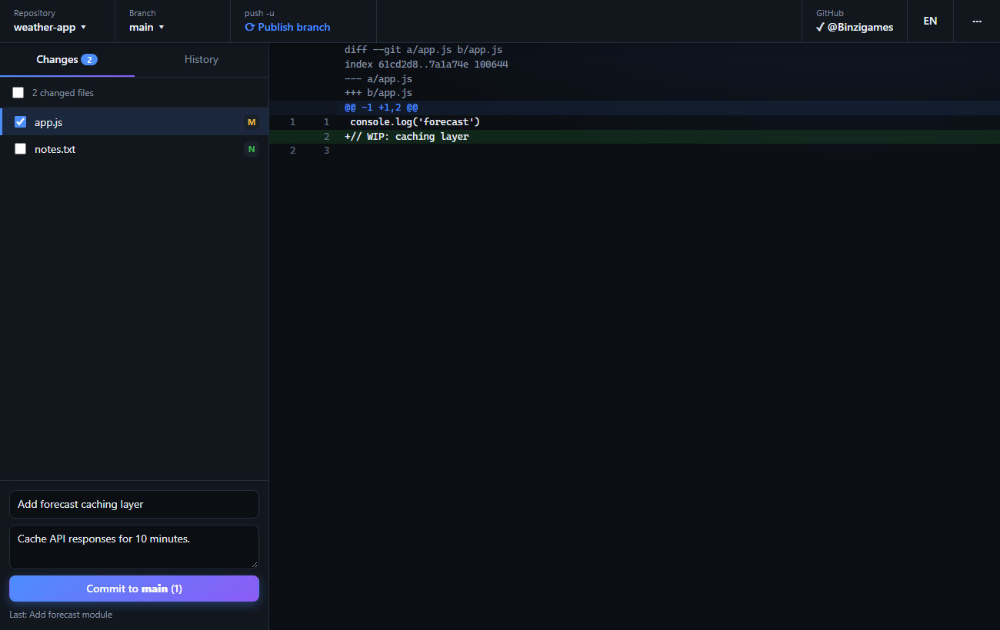
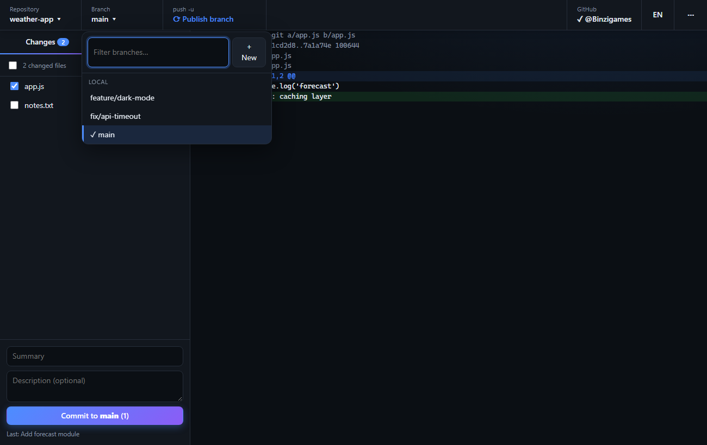

<div align="center">

# GitHub Helper

**A friendly, zero-dependency desktop-style UI for everyday Git & GitHub tasks on Windows.**

Commit, branch, sync, clone and publish — without memorizing a single command.

[](LICENSE)




</div>

---

## Why GitHub Helper?

Git is powerful, but the command line is intimidating for beginners, and full-blown Git clients can feel heavy.
GitHub Helper sits in the middle: a small, fast, single-window app that covers the 95% of Git you actually use every day,
and handles the awkward parts (installing Git, signing in to GitHub, publishing a first repository) for you.

It runs **entirely on your machine**. There is no cloud service, no telemetry and no account other than your own GitHub login.

## Features

| | |
|---|---|
| 📝 **Review & commit** | See every changed file with a color-coded diff with line numbers, tick what to include, write a summary and commit. |
| 🌿 **Branches** | Switch, create, filter, merge and delete branches from a single dropdown. |
| 🕘 **History** | Browse past commits, authors, dates and the exact diff of every file. |
| 🔄 **One-button sync** | A smart button that adapts to the repo state: *Publish branch*, *Pull*, *Push* or *Sync*. |
| ☁️ **Publish to GitHub** | Turn a local folder into a public or private GitHub repository in one click. |
| ⬇️ **Clone** | Clone by URL or `owner/repo` shorthand into a folder of your choice. |
| 🔐 **Sign in with GitHub** | Browser-based device login powered by the official GitHub CLI. |
| 🧰 **Auto-setup** | Missing Git or GitHub CLI? The app installs them for you via `winget`. |
| 📦 **Stash & undo** | Stash/pop work in progress, undo the last commit (keeping your changes), abort a merge. |
| 🚀 **Quick actions** | Open on GitHub, create a Pull Request, open in Explorer, VS Code or a terminal. |
| 🌍 **Bilingual** | English and Ukrainian interface, switchable on the fly. |
| 🎨 **Customizable UI** | Pick a theme (system / dark / light), an accent color, text and code size, and list density — saved automatically. |

## Screenshots

<table>
  <tr>
    <td width="50%"><br><sub><b>History</b> — browse commits and inspect diffs</sub></td>
    <td width="50%"><br><sub><b>Branches</b> — filter, switch and create branches</sub></td>
  </tr>
  <tr>
    <td width="50%"><br><sub><b>Appearance</b> — theme, accent color, sizes and density</sub></td>
    <td width="50%"><br><sub><b>Quick actions</b> — stash, undo, open in your editor or on GitHub</sub></td>
  </tr>
</table>

## Getting started

### Requirements

- Windows 10 / 11
- Windows PowerShell 5.1 (preinstalled with Windows)
- Microsoft Edge (preinstalled) — any default browser works as a fallback

Git and the GitHub CLI (`gh`) are **optional to install beforehand**: GitHub Helper can set them up for you.

### Run

```bash
git clone https://github.com/Binzigames/GitHubHelper.git
cd GitHubHelper
start.cmd
```

Or simply double-click **`start.cmd`**. The app opens in its own window.

### Command-line options

`server.ps1` accepts a few switches if you want to run it directly:

```powershell
powershell -NoProfile -STA -ExecutionPolicy Bypass -File .\server.ps1 [-Port 47321] [-NoBrowser] [-SkipInstall]
```

| Option | Description |
|---|---|
| `-Port <n>` | Port for the local server (default `47321`). |
| `-NoBrowser` | Do not open a window automatically. |
| `-SkipInstall` | Never offer to install Git / GitHub CLI. |

## How it works

```
┌──────────────┐   HTTP (127.0.0.1)   ┌──────────────┐   git / gh   ┌────────────┐
│  index.html  │ ───────────────────▶ │  server.ps1  │ ───────────▶ │  your repo │
│  (UI, no JS  │ ◀─────────────────── │ (PowerShell) │ ◀─────────── │  & GitHub  │
│  frameworks) │        JSON          └──────────────┘              └────────────┘
└──────────────┘
```

- **`index.html`** — the whole interface in a single file: plain HTML, CSS and JavaScript, no build step.
- **`server.ps1`** — a tiny local web server written in PowerShell that translates UI actions into `git` and `gh` commands.
- **`start.cmd`** — launcher that starts the server with the right flags.

Your list of repositories is stored in `%APPDATA%\GitHubHelper\repos.json`. Nothing else is persisted.

## Security & privacy

GitHub Helper is designed to be safe to run on a personal machine:

- The server binds to **`127.0.0.1` only** — it is not reachable from the network.
- Every API call requires a **random per-session token** and is checked against the expected `Host` and `Origin`.
- A strict **Content-Security-Policy** and anti-framing headers are sent with every response.
- Secrets in command output are **masked** before being shown in the UI.
- Authentication is delegated to the official **GitHub CLI** — the app never sees or stores your password.
- The server exits automatically within seconds of closing the window, so nothing is left running in the background.

## Contributing

Issues and pull requests are welcome! If you have an idea or found a bug, please open an issue.
The project intentionally has **no dependencies and no build tooling** — please keep it that way.

## License

Released under the [MIT License](LICENSE) © 2026 Binzigames.
