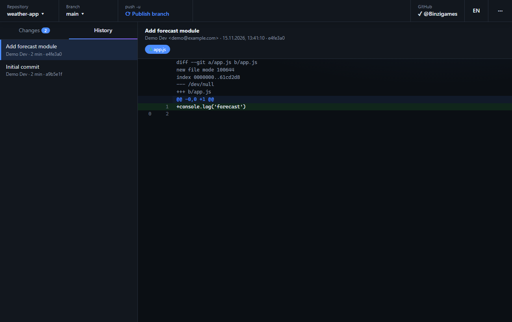
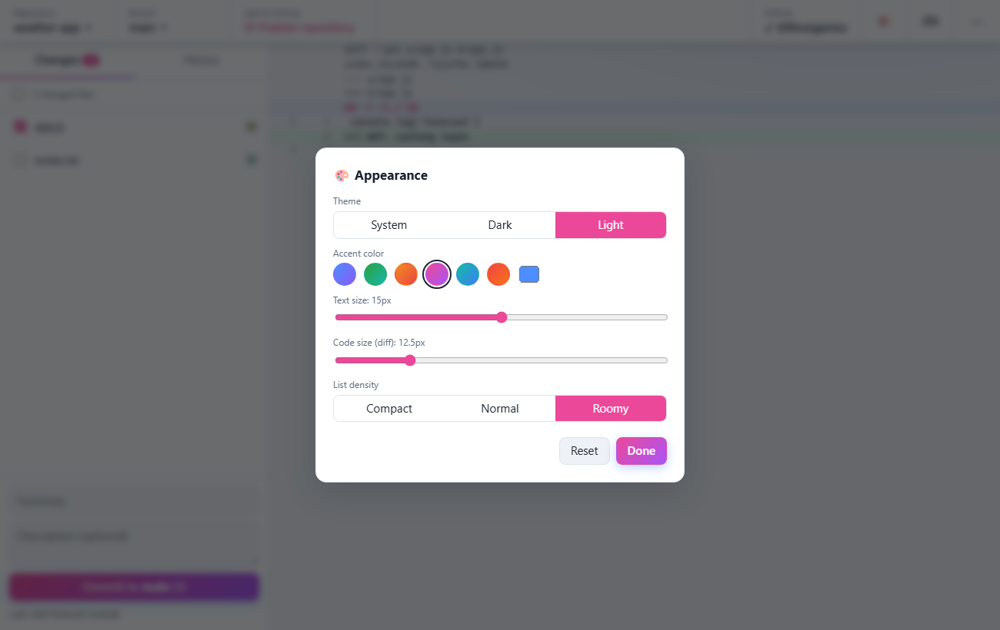
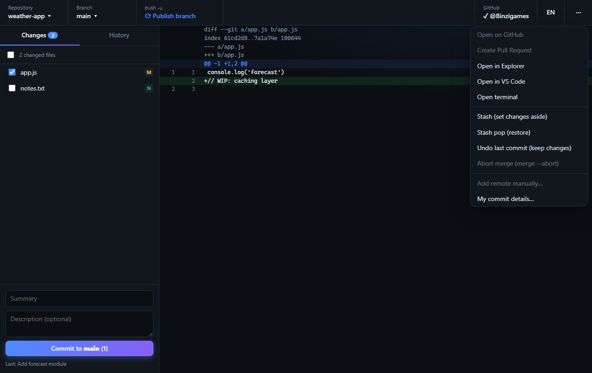

<div align="center">

# GitHub Helper

**A friendly, zero-dependency desktop-style UI for everyday Git & GitHub tasks on Windows, macOS and Linux.**

Commit, branch, sync, clone and publish — without memorizing a single command.

[](LICENSE)


</div>

---

## Why GitHub Helper?

Git is powerful, but the command line is intimidating for beginners, and full-blown Git clients can feel heavy.
GitHub Helper sits in the middle: a small, fast, single-window app that covers the 95% of Git you actually use every day,
and handles the awkward parts (installing Git, signing in to GitHub, publishing a first repository) for you.

It runs **entirely on your machine**. There is no cloud service, no telemetry and no account other than your own GitHub login.

## Features

| | |
|---|---|
| 📝 **Review & commit** | See every changed file with a color-coded diff with line numbers, tick what to include, write a summary and commit. |
| 🌿 **Branches** | Switch, create, filter, merge and delete branches from a single dropdown. |
| 🕘 **History** | Browse past commits, authors, dates and the exact diff of every file. |
| 🔄 **One-button sync** | A smart button that adapts to the repo state: *Publish branch*, *Pull*, *Push* or *Sync*. |
| ☁️ **Publish to GitHub** | Turn a local folder into a public or private GitHub repository in one click. |
| ⬇️ **Clone** | Clone by URL or `owner/repo` shorthand into a folder of your choice. |
| 🔐 **Sign in with GitHub** | Browser-based device login powered by the official GitHub CLI. |
| 🧰 **Self-contained** | No Git or GitHub CLI on the machine? The app downloads its own private copies on first start (no installer, no admin rights) and shows the progress. |
| 📊 **Live progress** | Downloads, updates, clone, fetch, pull and push show a progress bar with percent and speed. |
| 📦 **Stash & undo** | Stash/pop work in progress, undo the last commit (keeping your changes), abort a merge. |
| 🚀 **Quick actions** | Open on GitHub, create a Pull Request, open in Explorer, VS Code or a terminal. |
| 🌍 **Bilingual** | English and Ukrainian interface, switchable on the fly. |
| 🎨 **Customizable UI** | Pick a theme (system / dark / light), an accent color, text and code size, and list density — saved automatically. |

## Screenshots

<table>
  <tr>
    <td width="50%"><br><sub><b>History</b> — browse commits and inspect diffs</sub></td>
    <td width="50%"><br><sub><b>Branches</b> — filter, switch and create branches</sub></td>
  </tr>
  <tr>
    <td width="50%"><br><sub><b>Appearance</b> — theme, accent color, sizes and density</sub></td>
    <td width="50%"><br><sub><b>Quick actions</b> — stash, undo, open in your editor or on GitHub</sub></td>
  </tr>
</table>

## Getting started

The project has one client per platform, each in its own folder, sharing the same UI (`ui/`):

| Folder | Platform | Server |
|---|---|---|
| [`windows/`](windows) | Windows 10 / 11 | PowerShell 5.1 (`server.ps1`, launched by `start.cmd`) |
| [`linux/`](linux) | Linux | Python 3.7+ (`server.py`, launched by `start.sh`) |
| [`mac/`](mac) | macOS 10.13+ | the same Python server (`linux/server.py`), launched by `start.command` or the `.app` build |

Git and the GitHub CLI (`gh`) are **not required beforehand**. On Windows the app downloads private portable copies (MinGit + `gh`, checksum-verified) into `%LOCALAPPDATA%\GitHubHelper\tools` on first start; on Linux / macOS it fetches `gh` the same way (into `~/.local/bin`) and offers to install Git through the system package manager (Git cannot be bundled there). Installed system-wide copies are used when present.

### Quick start (any OS)

The **`start.cmd`** in the repo root works on both systems — double-click it on Windows, or run `./start.cmd` on Linux (it hands over to the right client).
Once the app window is open the console closes by itself.

### macOS

Requirements: `python3` (macOS asks to install the Command Line Tools on first use: `xcode-select --install`) and, ideally, Chrome / Edge / Brave for the app-style window (Safari works through the default-browser fallback).

```bash
git clone https://github.com/Binzigames/GitHubHelper.git
cd GitHubHelper
./mac/start.command        # or double-click mac/start.command in Finder
```

On first start the app adds **`~/Applications/GitHub Helper.app`** (icon included — find it in Launchpad / Spotlight). Missing Git / `gh` are installed through Homebrew when available (`gh` otherwise via a checksum-verified download into `~/.local/bin`; for Git use `xcode-select --install`).
Your repository list lives in `~/Library/Application Support/GitHubHelper/`.

**Self-contained build** (a `.app` you can zip and hand to someone — it carries its own copy of the program and auto-updates itself):

```bash
./mac/build-app.sh dist     # → dist/GitHub Helper.app
```

Optionally the same build can run in the cloud: copy [`mac/build-mac.yml.example`](mac/build-mac.yml.example) to `.github/workflows/build-mac.yml` (pushing a workflow file needs `gh auth refresh -s workflow`), then run it manually or push a `v*` tag to get `GitHub-Helper-macOS.zip` attached to the release.
The build is not code-signed, so on first open use right-click → **Open** (or `xattr -dr com.apple.quarantine "GitHub Helper.app"`).

### App icon and menu entry

GitHub Helper ships with its own icon ([`assets/`](assets)) and registers itself as a regular app named **GitHub Helper** on first start, so you don't need to run `start.cmd` by hand:

- **Windows** — a Start Menu entry (type "GitHub Helper" in Start; pin it to the taskbar if you like). For a Desktop shortcut too: `powershell -File windows\create-shortcut.ps1 -Desktop`.
- **macOS** — `~/Applications/GitHub Helper.app`.
- **Linux** — an application-menu entry (`~/.local/share/applications/githubhelper.desktop`).

Opt out with `-NoShortcut` (Windows) or `--no-shortcut` (Linux). `assets/make-icons.ps1` regenerates `icon.png` / `icon.ico` from the logo.

### Auto-update

On every start a title screen shows the current version while the app checks the `VERSION` file on GitHub (`main` branch).
If a newer version exists, it is installed automatically and the app restarts itself on the same window:

- a **git clone** is updated with `git pull --ff-only` — and only if it has no local changes (otherwise the update is skipped);
- a **downloaded copy** (no `.git`) is updated from the repository's `main` zip.

If you're offline or the check fails, the app simply starts. Pass `-NoUpdate` (Windows) or `--no-update` (Linux) to disable the check.
To publish a release as the maintainer: bump the number in [`VERSION`](VERSION) and push to `main`.

### Windows

Requirements: Windows PowerShell 5.1 (preinstalled) and Microsoft Edge (preinstalled; any default browser works as a fallback).

```bash
git clone https://github.com/Binzigames/GitHubHelper.git
cd GitHubHelper
start.cmd
```

The app opens in its own window and the console is hidden; the server log is `%APPDATA%\GitHubHelper\server.log`.
To see the server output, run `server.ps1` directly (below).

`server.ps1` accepts a few switches if you want to run it directly:

```powershell
powershell -NoProfile -STA -ExecutionPolicy Bypass -File .\windows\server.ps1 [-Port 47321] [-NoBrowser] [-SkipInstall] [-NoUpdate] [-NoShortcut]
```

| Option | Description |
|---|---|
| `-Port <n>` | Port for the local server (default `47321`). |
| `-NoBrowser` | Do not open a window automatically. |
| `-SkipInstall` | Never offer to install Git / GitHub CLI. |
| `-NoUpdate` | Do not check GitHub for a newer version. |
| `-NoShortcut` | Do not create the Start Menu entry. |

### Linux

Requirements: `python3` (3.7+, standard library only) and a browser (Chrome / Chromium / Edge / Brave open in their own app-style window; anything else falls back to `xdg-open`).
Optional helpers: `zenity` or `kdialog` for the folder picker, `xdg-open` for "open in file manager".

```bash
git clone https://github.com/Binzigames/GitHubHelper.git
cd GitHubHelper
chmod +x start.cmd linux/start.sh   # only if the executable bit was lost
./start.cmd        # or ./linux/start.sh
```

Once the window is open the server detaches from the terminal; its log is `~/.config/GitHubHelper/server.log`.

```bash
python3 linux/server.py [--port 47321] [--no-browser] [--no-autoexit] [--foreground] [--no-update]
```

| Option | Description |
|---|---|
| `--port <n>` | Port for the local server (default `47321`). |
| `--no-browser` | Do not open a window automatically. |
| `--no-autoexit` | Keep running after the window is closed. |
| `--foreground` | Stay attached to the terminal instead of detaching. |
| `--no-update` | Do not check GitHub for a newer version. |
| `--no-shortcut` | Do not add the application-menu entry. |

Missing Git / GitHub CLI are installed from the app's banner via `apt` / `dnf` / `pacman` / `zypper` / `apk` (asks for privileges through `pkexec` or `sudo`);
`gh` falls back to a checksum-verified download into `~/.local/bin`.
Your repository list is stored in `~/.config/GitHubHelper/repos.json`.

### Unity package

Open GitHub Helper from inside the Unity Editor (**Window → GitHub Helper**, Ctrl/Cmd+Shift+G) — it opens on the current project.
In Package Manager choose **Add package from git URL** and paste:

```
https://github.com/Binzigames/GitHubHelper.git?path=/unity/com.binzigames.githubhelper
```

See [unity/com.binzigames.githubhelper](unity/com.binzigames.githubhelper/README.md). The app itself also accepts `-Repo <folder>` (Windows) / `--repo <folder>` (Linux, macOS) to open on a given folder.

## How it works

```
┌──────────────┐   HTTP (127.0.0.1)   ┌──────────────┐   git / gh   ┌────────────┐
│ ui/index.html│ ───────────────────▶ │  server.ps1  │ ───────────▶ │  your repo │
│  (UI, no JS  │ ◀─────────────────── │  or server.py│ ◀─────────── │  & GitHub  │
│  frameworks) │        JSON          └──────────────┘              └────────────┘
└──────────────┘
```

- **`ui/index.html`** — the whole interface in a single file: plain HTML, CSS and JavaScript, no build step. Shared by both clients.
- **`windows/server.ps1`** — a tiny local web server written in PowerShell that translates UI actions into `git` and `gh` commands; `windows/start.cmd` launches it.
- **`linux/server.py`** — the same server for Linux, written in Python (standard library only); `linux/start.sh` launches it.

Your list of repositories is stored in `%APPDATA%\GitHubHelper\repos.json` (Windows) or `~/.config/GitHubHelper/repos.json` (Linux). Nothing else is persisted.

## Security & privacy

GitHub Helper is designed to be safe to run on a personal machine:

- The server binds to **`127.0.0.1` only** — it is not reachable from the network.
- Every API call requires a **random per-session token** and is checked against the expected `Host` and `Origin`.
- A strict **Content-Security-Policy** and anti-framing headers are sent with every response.
- Secrets in command output are **masked** before being shown in the UI.
- Authentication is delegated to the official **GitHub CLI** — the app never sees or stores your password.
- The server exits automatically within seconds of closing the window, so nothing is left running in the background.

## Contributing

Issues and pull requests are welcome! If you have an idea or found a bug, please open an issue.
The project intentionally has **no dependencies and no build tooling** — please keep it that way.

## License

Released under the [MIT License](LICENSE) © 2026 Binzigames.
